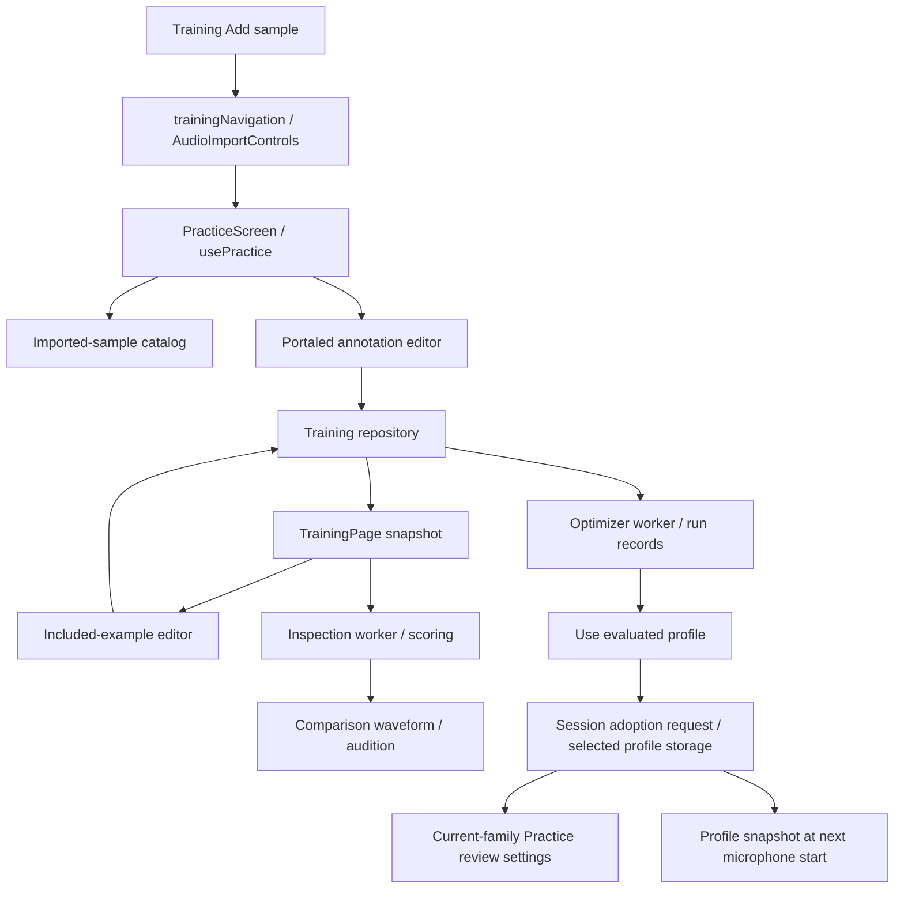

# Training architecture navigation

Training spans two mounted workspaces, shared session state and separate local stores. Start here to locate a change; use the linked workflow documents for behavioral contracts.

## Ownership

Source paths below are relative to `src/`.

| Owner | Responsibility |
| --- | --- |
| [TrainingShell](../src/components/TrainingShell.tsx) | Keeps `PracticeScreen` and `TrainingPage` mounted; routes control visibility through `active` and `hidden`. Installs navigation and awaits workspace guards. Mount lifetime preserves state, but individual effects still stop work when inactive. |
| [PracticeScreen](../src/components/PracticeScreen.tsx) | Owns `usePractice`, import-to-annotation transitions and the new-sample editor. Portals its training tools into `TrainingPage`'s `training-import-panel`; visible location does not identify state ownership. |
| [usePractice](../src/audio/use-practice.ts) | Owns retained-take/import state, pending samples, detector review settings, microphone lifecycle and bar replay. Restores the imported-sample catalog and publishes summaries through `PracticeScreen`. |
| [training-session](../src/lib/training-session.ts) | `useTrainingSession` bridges sample summaries, import reports/status, current parameters, optimizer progress and an adoption request. `trainingNavigation` holds picker/open-sample/navigation callbacks and asynchronous guards. It is an in-memory bridge, not dataset persistence. |
| [TrainingPage](../src/components/TrainingPage.tsx) | Owns dataset snapshots, file/bar selection, comparison profile/results, inspection worker and editing of already-included examples. `trainingExampleTake` adapts dataset PCM/reference into editor input. Hosts the optimizer and the import portal target. |
| [TrainingAnnotationEditor](../src/components/TrainingAnnotationEditor.tsx) | Owns editor UI, unsaved-work decisions and audition status. [TrainingAnnotation](../src/audio/training-annotation.ts) owns draft/reference/bar operations and repository commits; [useImportDetections](../src/audio/use-import-detections.ts) supplies suggested detections. |
| [WaveformDisplay](../src/components/WaveformDisplay.tsx) | Owns viewport, marker/range selection and one-shot output through `AudioRegionPreview`. Callers supply PCM, reference, markers, edit callbacks and activity; callers retain authoritative labels. |
| [TrainingOptimizer](../src/components/TrainingOptimizer.tsx) | Owns search worker lifecycle, progress, run history, freeze/withheld actions and explicit profile adoption. Search/scoring policy lives in audio modules, not the component. |

## Data flow

Import runs through [AudioImportControls](../src/components/AudioImportControls.tsx), `usePractice` and [training-import](../src/audio/training-import.ts). Imported files can exist in the catalog with no saved training bars. Saving reviewed annotations admits examples to the canonical dataset. Existing examples instead open an editor owned by `TrainingPage`; both paths share the editor/controller and repository.

Dataset commits notify same-window listeners with `forgettime-training-changed` and other windows through the `forgettime-training` BroadcastChannel. Readers refresh snapshots; fingerprints protect writes and invalidate comparison/search results. Shared Zustand summaries do not replace repository reads.

## State and persistence boundaries

| State | Owning boundary |
| --- | --- |
| Working take, import setup, editor draft, selected bar/view | Hook/component/controller memory; latest-take recovery is a separate cache described in [take review](take-review.md). Annotation drafts have no automatic persistence. |
| Imported source catalog | [training-sample-catalog](../src/audio/training-sample-catalog.ts), IndexedDB `forgettime-imported-samples`; independent of training inclusion. |
| Authoritative source PCM, reviewed examples and groups | [training-dataset](../src/audio/training-dataset.ts), IndexedDB `forgettime-training`; validated contract/transfer boundary, atomic writes and fingerprint checks. |
| Search history and completion/freeze/withheld state | [training-optimizer-records](../src/audio/training-optimizer-records.ts), IndexedDB `forgettime-optimizer`; run metadata rather than an audio/annotation archive. |
| Explicitly selected optimized parameters | Local storage `forgettime-training-profile`; validated on read. Comparison selection itself is component-local. |

## Comparison, playback and adoption

- **Comparison:** `TrainingPage` sends a dataset snapshot and selected parameters to [training-inspection.worker](../src/audio/training-inspection.worker.ts). [training-inspection](../src/audio/training-inspection.ts) analyzes source PCM from frame zero and delegates authoritative matching to [training-scoring](../src/audio/training-scoring.ts), using optimizer coverage policy. Results are keyed by dataset fingerprint and parameters; profile selection here does not adopt a microphone profile.
- **Optimization:** [training-optimizer.worker](../src/audio/training-optimizer.worker.ts) executes [training-optimizer](../src/audio/training-optimizer.ts). The component owns cancellation/staleness checks and persistence. Persistent mounting allows a search to survive route navigation; inspection workers are separately tied to Training activity and inputs.
- **Audition:** `WaveformDisplay` owns [AudioRegionPreview](../src/audio/audio-region-preview.ts) for source-frame one-shot marker/range playback. Its imperative `stop` handle and activity props let editors/pages stop output on transitions. Audition does not run scoring or microphone acquisition.
- **Practice replay:** `usePractice.playBar` owns [createBarReplay](../src/audio/replay.ts), which reanalyzes retained audio against its fixed reference. This is distinct from waveform audition and dataset inspection.
- **Adoption:** `TrainingOptimizer` writes selected parameters to local storage and publishes `current`/`adopt` in the session bridge. `TrainingPage` receives the selected profile; `PracticeScreen` consumes the adoption request and applies current-family settings to review when the source is not microphone. Mel adoption does not configure Practice review. [selectedMicrophoneProfile](../src/audio/live-detector.ts) validates the stored profile; `usePractice.listen` snapshots it at explicit microphone start. Both families can drive that new session; an active session retains its starting profile and invalid/absent selection falls back to shared defaults. The optimizer's notice text still says live capture keeps defaults; follow the capture code and [optimizer contract](training-optimizer.md) for this boundary.

## Task navigation and contracts

| Change | Start with | Detailed contract |
| --- | --- | --- |
| Import, duplicates, file membership | `PracticeScreen`, `usePractice`, `training-import`, `training-sample-catalog` | [Annotation workflow](training-annotation.md), [bar files](bar-files.md) |
| Desired attacks, uncertainty, bar/reference edits, unsaved navigation | `TrainingAnnotationEditor`, `training-annotation`, `trainingNavigation` guards | [Annotation](training-annotation.md), [frame/data contract](training-contract.md) |
| Comparison outcomes or stale results | `TrainingPage`, `training-inspection`, `training-scoring` | [Scoring](training-scoring.md) |
| Waveform selection, rendering or audition | `WaveformDisplay`, `audio-region-preview`; caller activity/stop wiring | [Take review](take-review.md) |
| Bar replay or capture profile lifecycle | `use-practice`, `replay`, `live-detector` | [Take review](take-review.md), [optimizer](training-optimizer.md) |
| Search, freeze, withheld evaluation or adoption | `TrainingOptimizer`, `training-optimizer`, worker and run store | [Optimizer](training-optimizer.md) |
| Dataset persistence or portable transfer | `training-dataset`, `training-contract`, `training-transfer` | [Storage](training-storage.md), [contract](training-contract.md) |

For validation claims and remaining device/acoustic limits, read [recorded-workflow validation](recorded-workflow-validation.md). This navigation document does not establish detector accuracy or device acceptance.
